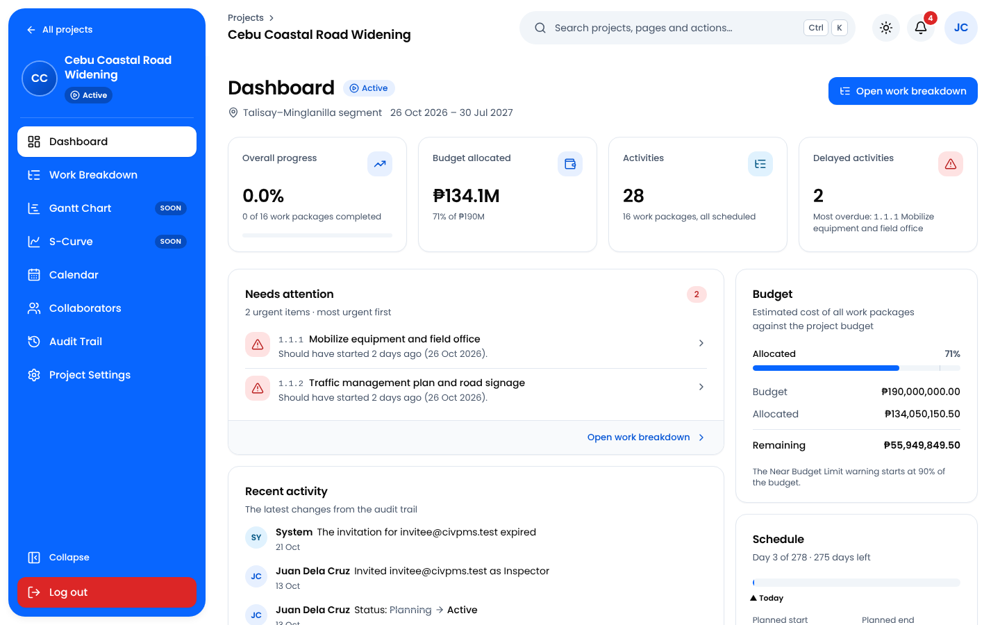
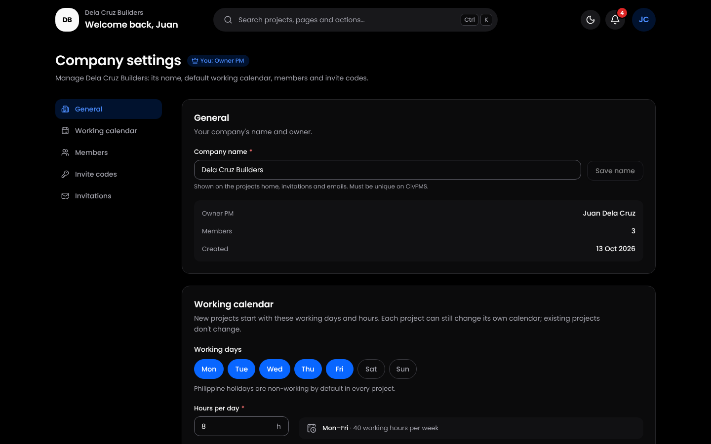
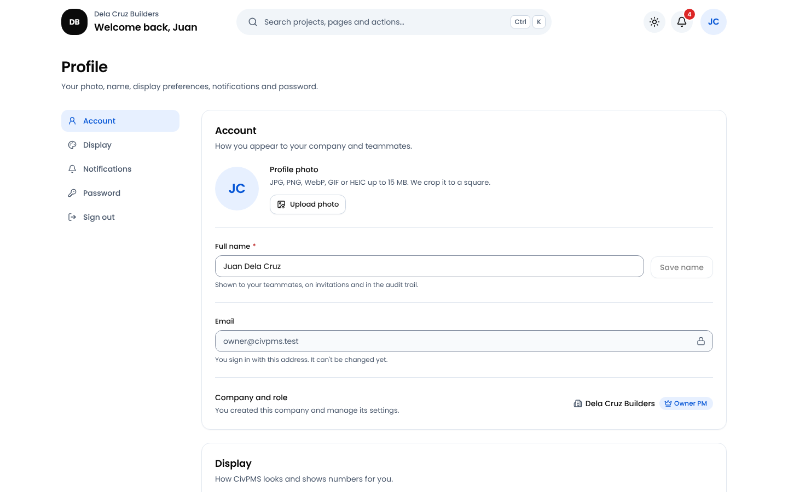
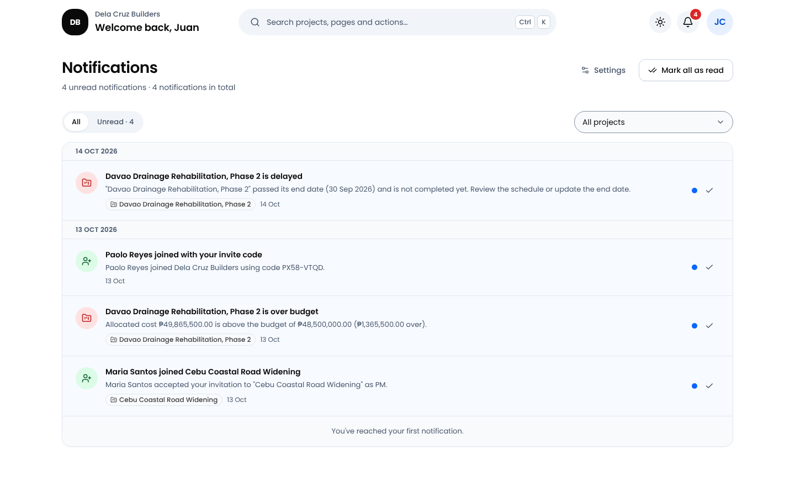
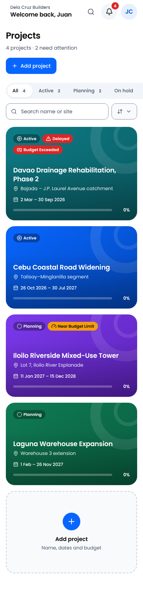
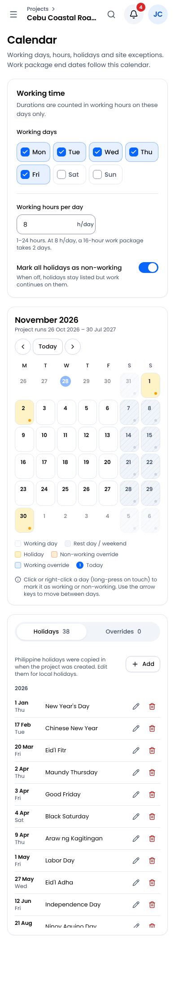
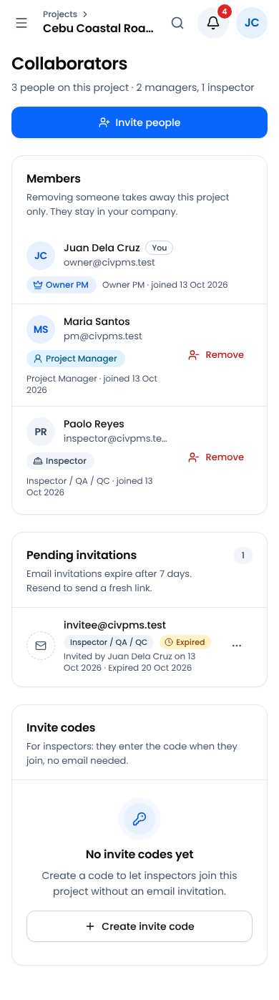

# CivPMS

**Project management for engineering and construction companies** — the planning depth of
Primavera and ProjectLibre, the field focus of Procore, with a modern, plain-language interface.
Built for Philippine contractors (₱, Asia/Manila, PH holidays) but not tied to them.

> Status: **Phases 0–1 (foundations + planning core) are built and verified** — type check, lint,
> 766 unit tests, production build, the full Playwright suite and a golden-path run on brand-new
> accounts. Gantt, dependencies/CPM, progress updates, inspections, S-curve, sharing, offline and
> import/export come next (see [docs/HANDOFF.md](docs/HANDOFF.md)).


## Features (Phases 0–1)

- **Accounts & onboarding** — email + password sign-up (Google ready to switch on), a 3-step
  onboarding: name → role → create your company (Project Managers) or join with an invite code /
  email invitation (Inspectors / QA / QC). "No company yet" state for people still waiting.
- **Companies & teams** — Owner PM, PMs and inspectors; company-wide and project invite codes
  (`XXXX-XXXX`, expiry, usage limit, revocable, rate-limited); email invitations with 7-day
  links (Brevo); promote, demote and remove members.
- **Projects home** — colour-coded project cards with status, Delayed / Budget Exceeded / Near
  Budget Limit badges and progress; search, filters and sort kept in the URL; archive; delete
  with type-to-confirm, Undo and a 30-day Recently deleted.
- **Project workspace** — dashboard (KPIs, budget meter, needs-attention list), project settings
  with optimistic concurrency ("Changed by someone else — Reload / Keep mine"), status changes
  with reasons, collaborators, and an append-only **audit trail** with filters and CSV export.
- **Work breakdown (WBS)** — deliverables → sub-deliverables → work packages; inline edits,
  drag & drop and keyboard moves with Undo, delete with Undo and Recently deleted, durations
  in working hours or days, parents roll up cost, hours and dates from their work packages, a
  live budget bar, and a zoomable graph view.
- **Working calendar** — working days, hours per day, Philippine holidays 2026–2027 and
  per-project overrides; changing it previews which work packages move (old → new end date)
  before saving everything in one transaction.
- **Profile, company settings, notifications** — photo (256 px WebP), Hours | Days, theme,
  per-event in-app/email preferences with a daily digest, live notification bell (Realtime) and
  a notifications page.
- **Security** — Row Level Security on every table and `SECURITY DEFINER` RPCs that check the
  caller's role (including the plan lock on Completed/Cancelled projects): the database is the
  security boundary, never the UI. Append-only audit log written by triggers.
- **Design** — Poppins, primary blue `#0866FF`, light **and** dark mode, WCAG 2.1 AA colours,
  keyboard friendly (⌘/Ctrl+K command palette, visible focus), skeleton loading, plain-language
  errors, confirm dialogs for destructive actions and Undo snackbars.

## Screenshots

Demo company "Dela Cruz Builders" (seeded by `supabase/seed/demo.sql`), signed in as its Owner PM.

| | |
|---|---|
|  **Project dashboard** — KPIs, needs attention, budget, schedule |  **Dark mode** |
|  **Work breakdown** — inline edits, roll-ups, Delayed flags |  **WBS graph view** (dark) |
|  **Working calendar** — PH holidays, overrides, reschedule preview |  **Collaborators** — members, email invitations, invite codes |
|  **Audit trail** — append-only, filters, CSV export |  **Company settings** (dark) |
|  **Profile** — photo, Hours \| Days, theme, notification preferences |  **Notifications** |

<p>
  
  
  
</p>

Every gallery screen also exists as `-light`, `-dark` and `-mobile` (390 px phone):
[`docs/screenshots/final-*`](docs/screenshots). Per-feature screens: `f1-*` auth & onboarding,
`f2-*` projects home, `f3-*` project workspace, `f4-*` WBS & calendar, `f5-*` profile, company &
notifications. Regenerate the gallery with
`FINAL_SHOTS=1 BASE_URL=http://localhost:3000 npx playwright test e2e/final-screenshots.spec.ts`.

## Stack

Next.js 16 (App Router, React 19, TypeScript strict, Turbopack) on **Vercel** · Tailwind CSS v4 ·
radix-ui · sonner · cmdk · lucide · next-themes · react-hook-form + zod v4 · **Supabase**
(Postgres + RLS, Auth, Storage, Realtime, pg_cron) · **Brevo** transactional email · date-fns
(Asia/Manila) · Vitest · Playwright · optional Rust media service on **Render**.

## Quick start

Full step-by-step guide (Windows, Supabase dashboard settings, Vercel, Brevo, Google sign-in):
**[docs/SETUP.md](docs/SETUP.md)**.

```bash
npm install
cp .env.example .env.local   # fill in the Supabase URL + publishable key (see docs/SETUP.md)
npm run dev                  # http://localhost:3000
```

Demo accounts and projects: [supabase/seed/README.md](supabase/seed/README.md).

## Scripts

| Command | What it does |
|---|---|
| `npm run dev` | Development server on http://localhost:3000 |
| `npm run build` / `npm start` | Production build / serve it |
| `npm run lint` | ESLint |
| `npm run typecheck` | `next typegen` + `tsc --noEmit` |
| `npm test` | Vitest (domain logic, helpers) |
| `npm run test:e2e` | Playwright end-to-end tests against the live Supabase project |
| `npm run db:types` | Regenerate `src/lib/supabase/database.types.ts` |

### Tests

- **Unit** (`npm test`): pure business rules in `src/lib/domain` and server helpers.
- **Database** (`supabase/tests/*.sql`): RLS and RPC behaviour; each file runs in one transaction
  and rolls back (psql or the Supabase SQL editor).
- **End-to-end** (`npm run test:e2e`): Playwright against the live Supabase project. Specs sign in
  through `e2e/helpers/auth.ts` (needs `DEMO_PASSWORD` in `.env.local`) and tag their records
  (`[F3] …`, `[QA] …`). Opt-in specs: the golden path on fresh accounts
  (`e2e/final-golden-path.spec.ts`, `QA_STAMP` + `supabase/seed/qa-e2e.sql`), the media service
  (`e2e/final-media-service.spec.ts`) and the screenshot generators (`*_SHOTS=1`); each file's
  header says how to run it.

## Media service (optional)

`backend/` holds **civpms-media**, a small Rust service (axum + ffmpeg + Redis) for image
uploads (EXIF-stripped WebP) and cached, resilient reads. The web app works without it: when
`NEXT_PUBLIC_MEDIA_API_URL` is not set, profile photos are resized in the browser and uploaded
straight to Supabase Storage. It runs on Render as `civpms-media`
(<https://civpms-media.onrender.com>); set `NEXT_PUBLIC_MEDIA_API_URL` to that URL to use it.
Build, configure and deploy it (Render Blueprint `render.yaml`):
**[backend/README.md](backend/README.md)**.

## Project structure

```
src/
  app/              routes: (auth) sign-in & sign-up, onboarding, invite/[token], (app) home,
                    profile, settings, notifications, projects/[projectId]/…, auth/* and api/cron/*
  components/ui/    design-system primitives (no data access)
  components/shell/ top bar, user menu, notification bell, command palette, project sidebar
  components/<feature>/  feature components (projects, wbs, calendar, collaborators, audit, …)
  lib/domain/       pure business rules (calendar math, WBS, rollups, statuses, money) + tests
  lib/supabase/     browser / server / proxy clients and generated database types
  lib/email/        Brevo client and email templates
  server/           session context, queries (reads, RLS) and actions (writes: zod → RPC)
  proxy.ts          route protection (Next 16 "proxy", formerly middleware)
supabase/
  migrations/       schema, RLS, RPCs, triggers, cron jobs (applied to the live project)
  tests/            SQL test suites (RLS and RPC behaviour)
  seed/             demo data, e2e accounts and the demo cleanup script
  templates/        Supabase Auth email templates
e2e/                Playwright specs (one tenant per feature, tagged test data)
backend/            civpms-media (Rust)
docs/               DECISIONS, DATABASE, DOMAIN, DESIGN, SETUP, HANDOFF, screenshots
```

## Documentation

- [docs/HANDOFF.md](docs/HANDOFF.md) — build status, verification, known issues, owner actions, next steps
- [docs/DECISIONS.md](docs/DECISIONS.md) — product and technical decisions that extend the spec
- [docs/DATABASE.md](docs/DATABASE.md) — tables, RLS model, RPCs and error codes
- [docs/DOMAIN.md](docs/DOMAIN.md) — business rules in `src/lib/domain`
- [docs/DESIGN.md](docs/DESIGN.md) — design tokens, components, contrast results
- [CLAUDE.md](CLAUDE.md) — engineering guide and known pitfalls for contributors
